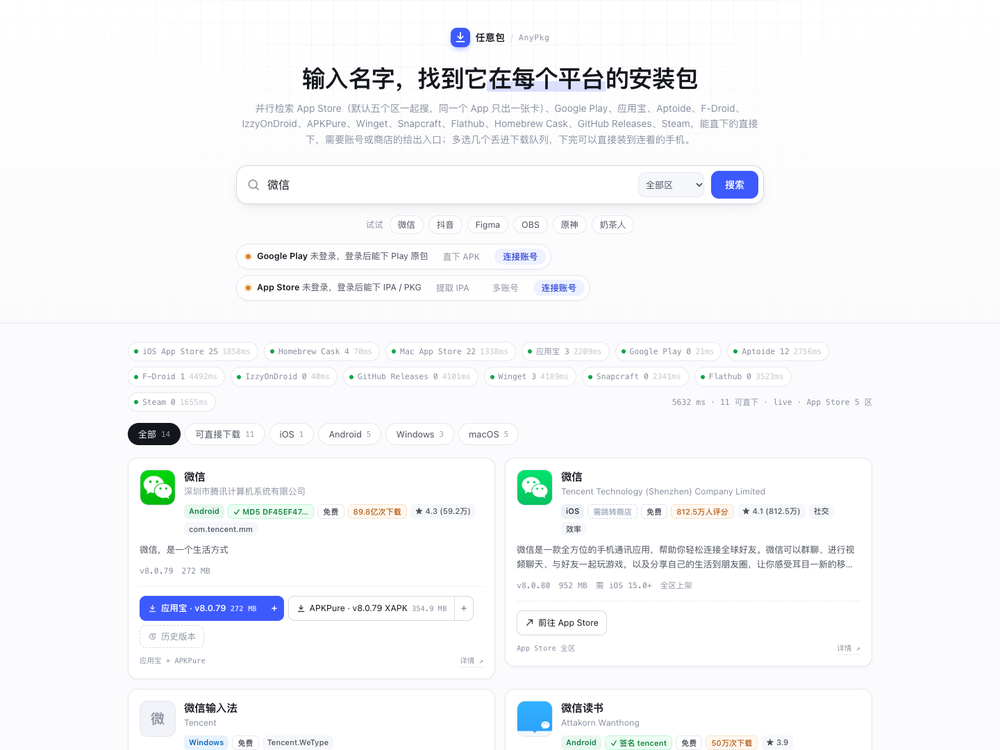
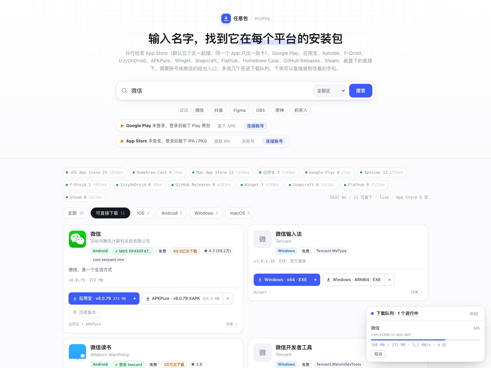

# 任意包 / AnyPkg

输入一个应用名，一次检索它在各平台的安装包。**能直下的点了就下到本地，只有商店的才跳转。**

```bash
node server.js          # 或 npm start
# → http://localhost:8787
```

默认只监听本机回环地址。若要通过局域网访问，设置 `HOST=0.0.0.0` 并提供至少 32 个字符的
`ANYPKG_REMOTE_TOKEN`。浏览器首次访问时使用 `http://设备地址:8787/?token=令牌`，服务会换成
HttpOnly Cookie 并立即从地址栏移除令牌；MCP 客户端在 `Authorization: Bearer <令牌>` 请求头中传入。
令牌通过明文 HTTP 传输，因此远程访问只适合可信局域网；不要暴露到公网。

```bash
ANYPKG_REMOTE_TOKEN="$(openssl rand -hex 32)" HOST=0.0.0.0 npm start
```

核心服务零依赖，需要 Node 20+。Winget 数据源需要 Node 22+ 的 `node:sqlite`，Node 20 会跳过该源。
设备安装是可选能力：装了 `adb` / `pymobiledevice3` 才会出现对应的「装到手机」按钮，没有也不影响搜索和下载。

`.downloads` 不会自动删除文件。目录占用达到 10 GiB 后，服务会拒绝新下载并提示手动清理；已在运行的下载允许完成，已有文件仍可安装和取回。当前占用与上限可在 `/api/health` 的 `downloadStorage` 字段查看。

## 功能界面

以下截图展示全平台搜索、直下筛选和下载队列。截图中的下载任务为虚构示例，不含账号或设备信息。






---

## 哪些平台真的能直下

| 平台 | 数据源 | 点击之后 |
|---|---|---|
| **macOS** | Homebrew Cask（6900 个应用） | 直接从厂商 CDN 下 `.dmg` / `.pkg` / `.zip` |
| **Android**（Play 原版） | Google Play（本机 Python 旁路，需登录一次） | 下 base + 分包，自动合并重签名成一个可安装 APK |
| **Android**（国内 App） | 应用宝公开页面 | 直接下 `.apk`，带版本、包大小、整包 MD5 |
| **Android**（国际 App） | Aptoide 公开 API | 直接下 `.apk`，带版本、包名、签名主体、恶意软件评级 |
| **Android**（开源） | F-Droid 官方仓库（免账号） | 直接下 `.apk`，带开源许可证和完整版本列表 |
| **Android**（开源，补齐 F-Droid 不收的） | IzzyOnDroid 仓库索引（免账号） | 直接下 `.apk`，带 sha256 与构建号 |
| **Android**（镜像补点） | APKPure App 接口（免账号） | 按包名补一条 `.apk` / `.xapk` 直链，带 sha1 与签名哈希 |
| **iOS / macOS** | 本机 ipatool（页面内登录） | 用自己的 Apple ID 取 `.ipa` / `.pkg`，可选设备与历史版本 |
| **Windows** | Winget 官方索引（免账号，本地 SQLite） | 直接下 `.exe` / `.msi` / `.msix`，按 x64 / ARM64 分按钮，带清单里的 SHA256 |
| **Linux** | Snapcraft 公开接口（免账号） | 直接下 `.snap`，按 x86_64 / ARM64 分按钮 |
| **Linux** | Flathub 官方仓库（免账号） | 直接下 `.flatpakref`（`flatpak install --from` 的输入） |
| **Android / iOS**（已连手机） | 本机 adb / pymobiledevice3 | 下完直接装到 USB 连着的设备，进度和日志都在页面上 |
| **Windows / macOS / Linux**（开源） | GitHub Releases | 直接下 `.exe` / `.msi` / `.AppImage` / `.deb` |
| iOS / macOS（仅商店版） | App Store | 只能跳商店 |
| PC 游戏 | Steam | 只能跳商店（DRM + 客户端） |

顶部有「可直接下载」筛选，一键只看能真正落到磁盘的结果。

### Android：国内应用宝，国际 Aptoide

两家互补，各补对方的盲区：

| 查询 | 应用宝 | Aptoide |
|---|---|---|
| 微信 | ✅ 8.0.79 | ✅ 8.0.58（旧） |
| 抖音 | ✅ 40.7.0 | ❌ 搜不到 |
| 小红书 | ✅ 9.50.0 | ❌ 搜不到 |
| WhatsApp | ❌ 不索引英文名 | ✅ 2.26.41.7 |

同一个包两边都有时（比如 QQ、百度），结果会合成**一张卡片两个按钮**，版本新的当主按钮，
另一个留作备用源——某个 CDN 抽风时还能换条路下。

应用宝这条路是免登录的，靠两个公开页面拼起来：

- `sj.qq.com/search?q=` 的 `__NEXT_DATA__` 里拿包名、版本、图标
- `a.app.qq.com/o/simple.jsp?pkgname=` 内嵌的 `window.systemData` 里拿 `apkUrl`、`apkMd5`、`fileSize`、`downCount`

`downCount.bytes` 是**全渠道累计下载量**（微信 89.8 亿次），也是判断「谁是这个应用的正主」
最硬的证据。2026-10 页面改版后它从 `download_num` 挪到了 `downCount`，旧的 `download_num`
已经不存在——解析代码里两个都认，新的优先。

这两个页面都很慢：搜索页 8 秒（700KB 服务端渲染），详情页单次 3.4 秒。所以详情只给最相关的
3 个结果补，并且按包名缓存 1 小时（失败冷却 5 分钟）；没补到的条目退化成「去商店」，
不再整条丢掉——之前详情超时会让「抖音」从列表里直接消失。

下完之后 `apkMd5` 可以自己核一遍。实测微信 8.0.79 的包，服务端吐出来的文件和页面声明的
MD5 完全一致。

应用宝分发的部分包带 `-yyb` 渠道标记（渠道统计用），签名与官方原包可能不同。要绝对原始的
Play 签名包，走下面的 Google Play 通道。

### F-Droid 与 APKPure：两条免账号的直链

这两家都不需要登录，但能力方向完全不同，所以接法也不一样。

**F-Droid** 是开源仓库，服务端直接调它的搜索页和包接口：

| 步骤 | 接口 | 拿到什么 |
|---|---|---|
| 搜索 | `search.f-droid.org/?q=`（HTML） | 包名、名称、简介、许可证 |
| 版本 | `f-droid.org/api/v1/packages/<pkg>` | 全部 versionName / versionCode |
| 下载 | `f-droid.org/repo/<pkg>_<versionCode>.apk` | 直链，无需签名参数 |

它是**独立数据源**，会参与关键词检索；只收名字真的对得上的结果（搜索页本身会按简介召回，
比如搜 `wechat` 会返回「可分享文件到微信」的工具，那类会被相关度打分丢掉）。

**APKPure** 反过来：网页和 `d.apkpure.com` 全在 Cloudflare 后面（实测 403 Just a moment），
但 App 端接口 `tapi.pureapk.com/v3/get_app_detail?package_name=` 是明文 JSON，返回的
`asset.url` 就是带 token 的 `data.winudf.com` 直链，中间没有 JS 挑战。

代价是**它没有可用的关键词搜索接口**（`/v3/search` 要 App 的 protobuf 请求体，实测 400），
所以它只做补点：合并完卡片、拿到包名之后，给最靠前的 5 个 Android 结果各补一条直链。
`XAPK` 是 base + 分包合集，装之前得先解压合并，按钮上会标出来。

补点还会改变排序：如果 APKPure 上的版本比 Aptoide 新（比如微信读书 7.5.2 vs 10.2.0），
版本号和主按钮都会换成新的，免得用户以为下到的是最新版。唯一例外是 Play 原版——
它按钮背后是官方签名和分包合并，不会被第三方镜像挤下主位。

**IzzyOnDroid** 是 F-Droid 的第三方仓库（1400+ 个应用），收录官方仓库不收的那些——
NewPipe 的各种 fork、各家开源客户端基本都在这儿。它没有可用的搜索页
（`/fdroid/index/search` 直接报模板错误），只有 16MB 的 `index-v1.json`，
所以做法是：整个索引拉一次、压成 1400 条精简记录（名称/简介/图标/sha256/`apkName`），
落盘缓存 6 小时，之后每次搜索都是内存过滤（实测第二次搜索 79ms）。

索引**过期时先用旧数据**、后台再刷新：16MB 在跨洋链路上偶尔要 20 秒以上，同步等它会把整个源
拖过 `runSource` 的 20 秒预算，现象是「Izzy 有时直接消失，而且每次搜索都卡 20 秒」。
服务启动时也会预载一次，第一次搜索不用等磁盘。

直链和官方仓库同构：`apt.izzysoft.de/fdroid/repo/<apkName>`，`apkName` 里带构建号。
索引里**没有 versionName**（要解包才知道），所以版本号留空——合并时它不会去抢
应用宝 / F-Droid 的主卡片位，只作为补充按钮出现。

### Google Play：登录一次，之后都能下原包

这是唯一能拿到**开发者原封不动签名**的安卓包的路子。用的是
[gplay-apk-downloader](https://github.com/alltechdev/gplay-apk-downloader) 的实现方式，
在 `gplay-server/` 里跑一个 Python 旁路服务，Node 侧只负责调度。

页面顶部有一条 Play 状态条，点「连接账号」，列表里是本机浏览器已经登录过的 Google 账号。点一个，按下面的顺序尝试：

1. **找本机存的密码**：先查 Chrome 的 `Login Data`，再查登录钥匙串。查不到是**常态**，
   原因见下一节。
2. **借已登录的 Chrome 领票据（推荐，不用密码）**：打开 `accounts.google.com/EmbeddedSetup`，
   在浏览器里点一下「继续」，Chrome 会领到一张一次性 `oauth_token`；程序从它的 cookie 库里
   读出来，换成长期 AAS token。这一步不需要重新输密码，因为会话本来就在浏览器里。
3. **手输密码**：走 ac2dm 的 `EncryptedPasswd`，本地 RSA 加密，不弹窗。
4. **浏览器登录 / 手动填 Token**：前两条都不行时的兜底，见弹窗里的两个标签页。

凭证只落在本机 `~/.gplay-auth.json` 和 `gplay-server/` 下，不上传任何地方。**建议用小号**：
Google 会风控出现在非官方客户端上的账号，主号被封不划算。

#### 为什么不能直接唤起钥匙串取密码

不是没做，是**取不到**，两条路都被系统堵死：

- **Chrome 的密码库**：`Login Data` 里存的是「网页表单」的密码。Google 账号的登录是浏览器
  自己的身份体系，Chrome 不会把它当表单保存，所以整个库里一条 `google.com` 记录都没有
  （这台机器 546 条密码，0 条 google.com）。
- **系统钥匙串**：macOS「密码」App 里的 Google 密码属于 iCloud 钥匙串，条目在
  `~/Library/Keychains/*-dm` 里。`security find-internet-password` 没有对应的 entitlement，
  **读不到**——这是系统限制，不是参数问题。本地登录钥匙串里也不会自动有这一条。

所以「点一下账号就自动填好密码」在这套系统上无数据可用。真正能免密的只有第 2 条：
借浏览器自己的会话，让 Google 给它发票据。

#### 为什么密码明明是对的，却提示密码错

Google 的 ac2dm 端点对可疑登录（代理/机房 IP、新设备、账号开了两步验证）会统一返回
`Error=BadAuthentication`，**不区分**「密码打错了」和「不许用密码登录」——这样设计是为了不让
攻击者探测账号状态。所以这个错误码不能字面理解。程序现在会把原始错误码和提交的密码长度
一起显示出来：长度对得上就别再重试密码了，直接走第 2 条。

> **浏览器登录在受限宿主里会崩 Chrome？** 已经处理了。IDE / Agent 这类带进程沙箱的环境
> 不允许 Chrome 初始化它自己的沙箱（`sandbox initialization failed: Operation not permitted`），
> GPU 与网络子进程会连续退出，最后 `FATAL: GPU process isn't usable. Goodbye.`，
> 用户看到的是 macOS 的「Google Chrome 意外退出」弹窗（DevTools 连接随之报
> `Connection to remote host was lost.`）。`account_auth.py` 现在会检测
> `CODEBUDDY_TOYBOX_SANDBOX_PROFILE` / `SANDBOX_CENTER_UID`，命中就带
> `--no-sandbox --disable-gpu --disable-dev-shm-usage` 起窗口；没命中也留了一次
> 「启动即崩 → 带破沙箱参数重试」的兜底。这个窗口只访问 accounts.google.com，
> profile 是临时的，代价可控。

拿到 token 之后，下载链路是：取 base APK → 按设备指纹取对应的 split 分包 → 用
[APKEditor](https://github.com/REAndroid/APKEditor) 合并成一个 APK → 用 debug keystore
重签名。所以弹出来的 APK 签名是「Android Debug」，不是 Google 的原签名——这是合并分包的
必然代价，包能装、功能完整，但**不能覆盖安装你手机上已有的官方版**（签名不同），得先卸载。

#### 慢线路上把包拆成 4 段拉

Play 的 CDN 单连接在本机只有 ~40 KB/s（代理限速），55 MB 要下半小时，中间一断就从头来。
所以超过 6 MB 的包会先用 `Range: bytes=0-0` 探一次：CDN 支持分块就切成 4 段并发
（`GPLAY_DOWNLOAD_PARTS` 可调，设 1 关掉），每段直接写进预分配 `bytearray` 的对应区段，
不用最后再拼一次；单段断了从已到达的位置续拉，只重开一条连接。

同一个包（Whering 55 MB）实测对比：

| | 速度 | 结果 |
|---|---|---|
| 单流 | 29 KB/s | 11 分钟只下到 14 MB，断了 |
| 4 段并发 | 337 KB/s → 1 MB/s | 1 分钟下完，合并签名共 4 分 49 秒 |

两个坑：

- **必须发 `Accept-Encoding: identity`**。带 gzip 时 Range 是按压缩后的字节切的，
  requests 又会拿半截 gzip 去解压，直接 `incorrect header check`。
- **分块模式只认 206**。服务器如果忽略 Range 回了 200，整包会覆盖掉别的段。
  探针不通过就老老实实退回单流，别让优化点变成新的故障点。

还有一个比上面两个更容易被改回去的坑：**「重试几次」不能写死成小数**。

`downloadSize` 报 207 MB 的包（Vita Mahjong）在这条线路上实测单连接 ~40 KB/s，而且
每 30~40 秒被掐一次（`ChunkedEncodingError: IncompleteRead`）——整个下载要断四十多次。
原来 `retry in range(2)` / `range(4)` 的写法等于必然失败，用户点「重试」也只是从 0 再来一遍。

现在的判据不是次数，而是**有没有前进**：

- 单流：`Range: bytes=<已收字节>-` 接着下，连续 4 次重连一字节未进才认输，
  上限 `GPLAY_STREAM_RETRIES`（默认 40）。
- 分段：每段各自续，同样按「连续 4 次没推进」判死，上限 `GPLAY_SEG_RETRIES`（默认 60）。
- 分段整轮失败（某一段彻底卡住）时重开一轮，**复用同一份 `state`**：`buf` 和每段的 `pos`
  都还在，从断点继续。早期版本这里是「退回单流」，等于把已经下好的 100 MB 扔掉——
  208 MB 的包重下一次就是半小时，比直接报错更糟。

#### 重试不再从 0 开始（`partials.py`）

Play 的下载地址是每次请求现签的，token 绑在那一次请求上，所以 HTTP 层的 Range 续传**跨不了请求**：
用户点「重试」是一条全新的 SSE，上一轮攒在内存里的 `buf` 也随生成器一起没了——
208 MB 的包断在 192 MB，重试还是从 0 开始，等于永远下不完。

现在把字节按绝对偏移落到 `~/.cache/gplay-partials/`（`GPLAY_PARTIAL_DIR` 可改），进度写进同名
`.json`，key 是 `pkg|versionCode|arch`。几个不能改回去的细节：

- 落盘用 `os.pwrite`，在锁内、且在推进 `pos` **之前**完成，所以「下到哪了」永远不超前于盘上的数据。
  反过来（盘上比记录新）只是多下几百 KB；空洞是致命的——合并出来的包会坏。
- 分段模式预分配整包长度、4 条流各写自己的区间，互不覆盖；单流模式按追加偏移写，不预分配。
- 客户端断开时在生成器 `finally` 里强制写一次进度。断线通常落在两个进度 tick 之间，不补这一次，
  盘上数据是有的、但不知道下到哪了，等于白存（这个是自测里先踩到的）。
- 区间布局对不上（改过 `GPLAY_DOWNLOAD_PARTS`）或总长对不上（换了商店区拿到同名不同构建）
  就直接丢弃重下，绝不把两个来源的字节拼在一起。
- 成品落盘之后才清断点；中间任何一步（split、合并、签名）失败，重试都直接读盘。
- 同一个包被两个请求同时下时，`claim()` 给第二个换一个 key，避免两边往同一段写。
- 目录放 `~/.cache` 不放 `/tmp`：重启后还能接着下才是重点。默认 6 小时过期、总量 3 GB
  （`GPLAY_PARTIAL_TTL` / `GPLAY_PARTIAL_MAX_MB`），清理线程在动过的文件 10 分钟内不碰。

实测（Vita Mahjong，base 207.70 MB）：35 秒下到 201.52 MB 时掐断，重新发起后第一条事件就是
「继续上次的下载（已收 201.52 MB / 207.70 MB）」，只补 6 MB + 31.42 MB 的 split，
**37 秒**合并签名完成、`apksigner verify` 通过（改之前要从 0 再来，约 30 分钟）。

自测：`gplay-server/.venv/bin/python gplay-server/test_partials.py` 测零件（单流续传、区间落盘、
布局失配拒绝、并发 claim）；`env -u PYTHONPATH gplay-server/.venv/bin/python gplay-server/test_resume.py`
走 `sse_stream_download` 的两条真实路径，模拟「下到 60% 客户端断开再重开」，逐字节比对结果。

#### 队列里的直链下载也走同一套

`lib/queue.js` 是 APKPure / 应用宝 / Aptoide / F-Droid / IzzyOnDroid / GitHub Releases /
Winget / Snapcraft / Flathub 这些「给个 URL 就下」的渠道共用的执行器，所以分段逻辑放在这里
一次就全覆盖了（Play 那条是自己的 SSE 链，另算）。行为和 Play 版一致：6 MB 以上先探，
支持就切 4 段（`APD_DOWNLOAD_PARTS` 可调，设 1 关掉），不支持就当没这回事。

和 Python 版的三点差别，都是被 Node 的行为逼出来的：

- **不预分配到内存**，而是 `ftruncate` 出一个整包长度的 `.part`，每段用
  `fh.write(buf, off, len, pos)` 直接写自己的偏移。几百 MB 的包不能躺在内存里。
- **不用 `createWriteStream` + `pipe`**。写流会先攒内存，连接一断缓冲区里那几 MB 就丢了，
  `seg.pos` 也就不再等于「磁盘上真有的字节」，拿它当断点会写出一个洞。改成 `await fh.write()`
  之后再推进 pos，断点就是真的；实测一个 12 MB 文件在段中间被掐两次，服务器总共只多发 1 字节。
- **进度落在 `.part.json` 里**。`.part` 现在是「整包长度」，光看尺寸看不出下了多少，
  于是段位单独记一份。单流模式和分段模式不能共用同一个 `.part`（一个是长度=已下，
  一个是长度=整包），所以切回来之前必须先删；`.part` 被手动删过时状态也一并作废，
  否则会按旧段位续出一个全是空洞的文件。

断一段不牵连其他段：断了就地重连一次，不等另外三段跑完。反过来如果一断就 kill 全部，
在随机掉线的链路上会活锁——四段永远凑不齐一次全成功。

`scripts/_test-queue-parts.js` 是这套逻辑的验证脚本（本地起限速服务器，单连接 200 KB/s）：

| 场景 | 结果 |
|---|---|
| 支持 Range，12 MB | 15.7s，4 段，md5 一致 |
| 不支持 Range（永远 200） | 62.3s 单流，md5 一致 |
| 中间两段第一次断在 500 KB | 16.0s，断点续上，总共只传了 12 MB |
| 下到一半取消 | 状态 `canceled`，`.part` 和 `.part.json` 都没留 |

#### 不用先搜索：粘链接就能下
Play 状态条上除了「连接账号」，还有一个「直下 APK」：把
`https://play.google.com/store/apps/details?id=…`、`market://details?id=…` 或裸包名粘进去，
服务端先用 `/api/play/info` 把应用名读出来（取页面的 `og:title`，`h1` 现在套了 span，正则匹配不到），
再走同一条下载链路。这样搜不到的应用（只在别的区上架、名字对不上）也能直接下。

#### 「拿不到下载链接」和「登录失效」是两件事

Play 有两种完全不同的失败，混在一起处理会既慢又误导：

| 现象 | code | 真实原因 | 该怎么办 |
|---|---|---|---|
| 拿不到下载链接 | `no_delivery` | token 是好的，这个包在你账号所属的商店区拿不到（下架 / 区域限制 / 与虚拟设备不兼容） | 换区账号，或用卡片上的 APKPure / 应用宝 直链 |
| 商店里没这个包 | `not_found` | 详情接口 404，包不在当前区 | 同上 |
| 登录态失效 | `auth` 类 | token 过期 / 被撤销 | 顶部重新连接账号 |
| 付费应用 | `paid_app` | 只能下免费应用 | 自己去商店买 |

早先代码把前两种也当成 token 问题：每次都要重建一遍会话（8 秒）再报
`Could not get a working token (...)`——用户看到这句只会去重登，而重登不可能有用。
现在 `get_download_info` 返回结构化错误码，应用层失败（`not_found` / `no_delivery` /
`paid_app` / `incompatible`）直接跳过会话重建和指纹轮换，实测微信从 9.2 秒降到 2.6 秒，
提示也换成中文说明。

失败后弹窗里会直接长出第二个按钮「改用 APKPure 下载」：拿同一个包名问
`/api/apkpure?pkg=`，拿到直链就一键进队列（微信 v8.0.79 · 354.9 MB · XAPK，
TikTok v47.4.3 · 452.9 MB · APK）。从「直下 APK」进来的用户没有卡片可回，
这一步尤其必要——不然他就只能看着报错。APKPure 也没有的包（比如 Venmo）就不出按钮。

前置条件都由 `gplay-server/run.sh` 处理，它会自己找：

- Python 3.11+（`gplay-server/.venv` 是隔离环境，不污染系统）
- JDK 17（APKEditor 的要求，`brew install openjdk@17`）
- `apksigner`（Android SDK build-tools 里，不在 PATH 也能找到）

不想用 Play 完全没影响：状态条显示「旁路没起来」时其它源照常工作。

### macOS 为什么能直下

Homebrew Cask 的索引里存的是**厂商自己的下载地址**，不是镜像：

- 微信 → `dldir1.qq.com`（腾讯 CDN）
- Chrome → `dl.google.com`
- Figma → `desktop.figma.com`

索引 24 小时缓存一次（`.cache/casks.json`，压缩后约 2MB）。排序除了名字相关度，还用了
Homebrew 的 90 天装机量，否则搜「chrome」会把 Chrome Remote Desktop 排在 Google Chrome 前面。

### iOS / macOS 的 .ipa：网页拿不到，本机可以

**Apple 不提供任何公开的 IPA 下载接口**，App Store 的分发协议要求安装包只能由 App Store
客户端在用户本人 Apple ID 授权下解密安装。所以网页接口这条路走不通。

但**你自己的电脑上可以**——用 [ipatool](https://github.com/majd/ipatool)，这个项目已经把它接进来了：

```bash
brew install ipatool      # 装完刷新页面，顶部会多出一条 App Store 状态条
```

点状态条上的「连接账号」，用你自己的 Apple ID 登录（密码 → 两步验证码，两步都在页面里走完），
之后 iOS 和 Mac App Store 的卡片上就会出现「下载 IPA / PKG」。弹窗里可以选：

- **设备**：iPhone / iPad / Mac / Apple TV / Apple Watch / Vision Pro
- **版本**：默认最新版；点「加载历史版本」能挑旧的，回退版本时用得上

登录弹窗里还有个「从钥匙串读取」，会翻三类凭证：

| 来源 | 能拿到什么 | 能不能直接登录 |
|---|---|---|
| ipatool 自己存的（`security find-generic-password -s ipatool`，`acct=account/password`） | 账号 + 密码 | 能，一键登 |
| 本机「登录钥匙串」里的 `appleid.apple.com` / `itunes.apple.com` 网页密码 | 账号 + 密码 | 能，一键登 |
| 本机 iCloud 账号（`defaults read MobileMeAccounts`） | 只有邮箱 | 不能，回填账号后补密码 |

两点限制：**iCloud 钥匙串（「密码」App 里那些）读不到**，命令行的 `security` 拿不到那个
entitlement，只有本机 `login.keychain-db` 里的条目可读；首次读密码时系统可能弹一次
「security 想访问钥匙串」，允许即可。密码本体不出 `/api/apple/keychain`（只回 `hasPassword`），
真正要用时走 `/api/apple/keychain-login`，由服务端自己取。

下载有实时进度，包先落到 `.downloads/`，再交给浏览器。

几点必须说清楚：

- **下到的包仍是 FairPlay 加密的**，并且绑在你的账号上。它能装到你自己登录同一 Apple ID 的
  设备（配 Apple Configurator / iMazing），但**不是**可以随便分发的破解包。
- **只能下免费或你已购买的应用**。免费应用会自动领许可（`ipatool download --purchase`），
  付费的必须先在 App Store 里买过。
- **开发者可以选择不向第三方客户端提供下载**，这类会直接报错，不是这里的 bug。
- 凭证由 ipatool 存进 macOS keychain。网页只在你点「登录」的那一刻把密码交给本机进程，
  **不落盘、不写日志**；但它会短暂出现在进程参数里（`ps` 能看到），单人本机使用可以接受，
  多人共用的机器不要开这个服务。

这台机器访问 Apple 要走代理（`fpinit.itunes.apple.com` 直连是被断的，登录会卡在这里）：

```bash
PROXY=http://127.0.0.1:7897 node server.js   # 不设也行，会自动探 7897 / 7890 / 1087
```

第三方「IPA 库」分发的是破解 / 重签包，属于侵权且常被注入恶意代码，本工具不做聚合。

### 从第三方分发页提取 .ipa（不需要账号）

企业签名、内测分发、自建 OTA 页几乎都用同一套机制：

```
<a href="itms-services://?action=download-manifest&url=https%3A%2F%2F.../app.plist">
```

那个 plist 里就写着真正的 `.ipa` 地址和包信息。点顶部状态条的「提取 IPA」，把页面链接、
plist 链接或 `.ipa` 直链粘进去，就能拿到标题、包名、版本和体积。

这条路**不碰 App Store、不需要 Apple ID**——它只是把页面里已经公开的 OTA 清单读出来，
所以和 ipatool 那条完全独立：ipatool 装不上（没 Apple ID / 没有该应用）也能用。

解析是纯静态的，遇到前端渲染、登录后才吐链接的分发页会找不到东西，这时把 plist 或 `.ipa`
地址直接粘进来即可。下载走的还是 `/api/download`，同样过 SSRF 检查（只放行公网地址）。

包能不能装取决于它自己的签名和你设备上的描述文件，本工具不重签、不解密。

## 搜索结果怎么排序

13 个源各搜各的，同一张列表里混着「20 亿次下载的 Google Chrome」和「只在 Aptoide 上架的
同名壁纸应用」。排序做错，第一个结果就不是用户要的东西，所以这一段值得单独写清楚。

排序键依次是：**弱匹配垫底 → 相关度分档 → 热度 + 同名加分**。

**① 相关度分档，不直接比分数。** `relevance()` 只返回 100/92/88/84/60/45/0
（同名 / 整词命中 / 前缀 / 词首 / 包含 / 多词分散命中 / 无命中）。直接拿分数排，等于让
88 分和 84 分之间也分出胜负——实测会把「剪映」（84）排到「抖音极速版」（88）前面，
用户搜抖音，第二个结果却是另一个产品。所以只留三条硬边界：

| 档 | 含义 | 原始分 |
|---|---|---|
| 2 | 名字等于 / 以关键词开头 / 含关键词整词 | 100 / 92 / 88 |
| 1 | 名字包含关键词，或多词分别命中 | 84 / 60 / 45 |
| 0 | 文字完全没对上 | 0 |

「微信」永远不会被「微信读书」顶掉（档不同），但「Google Chrome」和「Chrome」同档，
要靠热度决出胜负。

**② 热度要压到同一把尺子上。** 各源给的指标根本不是一回事：应用宝/Aptoide 给下载量、
App Store 给评分人数、GitHub 给 star、Flathub 给月安装。所以按经验换算成 0~100 的对数刻度
（评分人数约等于 1% 的下载量，rating 的区间因此少两个数量级）：

```js
const HEAT_SCALE = {
  install: [3, 10],  // 1 千 ~ 100 亿次下载
  rating:  [1, 8],   // 10 ~ 1 亿人评分
  stars:   [1, 5],   // 10 ~ 10 万 star
};
```

没有热度数据的源（Winget、Snapcraft、F-Droid、Play）用「源内名次」折一个保底分
（源内第 0 名 25 分，每靠后一名减 4 分，最低 4 分）。不这么做的话，搜「微信」时 Play 那张卡
会掉到十几张冷门结果后面。

GitHub 的 star 还要再乘 0.5：3 万 star 在 star 刻度上是 87 分，但那只代表「一批开发者在关注」，
不打折的话搜 `telegram` 时 `python-telegram-bot` 会压过 Telegram 本体。

**③ 同名跨店收录给有限加分。** 这是唯一不依赖量纲的证据：搜 `chrome` 时 Aptoide 有个壁纸应用
名字就叫「Chrome」（485 万下载），搜 `figma` 时「Figma Mirror」有 500 万下载——
一个下载量、一个评分人数，谁高谁低纯属巧合。但「Google Chrome」在 5 家商店同名收录，
「Figma」在 3 家，而壁纸 Chrome 和 Figma Mirror 只有 1 家。

每多一家商店 +15 分、封顶 +45。**加分不能当主排序键**：搜「抖音」时「抖音聊天」在两家店收录，
可它只有 10 次下载，真按收录数排会压住 982 万人评分的极速版。

实测结果（`?fresh=1`）：

| 查询 | 排序 |
|---|---|
| `chrome` | Google Chrome ×5（Android/iOS/Linux/macOS/Windows）→ Chrome Beta → Chrome Dev → 同名壁纸 Chrome |
| `figma` | Figma（3 店）→ Figma Mirror |
| `微信` | 微信（应用宝 89.8 亿次）→ 微信（App Store 811.8 万人评分）→ 微信输入法 |
| `抖音` | 抖音（5211 万人评分）→ 抖音（应用宝 8.8 亿次）→ 抖音极速版 → 抖音火山版 |

界面上每个热度徽章都带 `title`：`热度 90/100 · 20亿次下载（Aptoide）· 5 家商店同名收录`，
排序凭什么这么排，鼠标停一下就能看到。

## 下载队列与「装到手机」

所有能拿到的东西最后都进右下角这一个列表：直链、Play 合并包、App Store 的 IPA。

- **＋**：加入本机下载队列（文件落在 `.downloads/`）
- **📱**（顶栏选中了设备、且平台对得上时）：下载后自动装到这台设备

队列在服务端跑，不在浏览器里，原因有三个：浏览器会把多个大文件挤进同一个连接池、进度只在
系统下载器里、而且「下完装到手机」要求文件先落在本机固定目录。

### 下载可以随时丢到后台

弹窗里点「后台下载」就收起窗口，去搜下一个应用；进度在右下角继续走。甚至**关掉标签页、
刷新页面**也不影响：Play 那条上游不会因为客户端断开而中断，Apple 的 ipatool 进程本来就跟
HTTP 请求无关，跑完照样落盘进队列。

队列里显示的是**应用名**（「奶茶人」），下面一行小字才是文件名（`com.sanjie.sipor_…ipa`）。
包名对用户没有信息量，但排查「到底下的是哪个包」时又必须有，所以两行都留。应用名来自搜索
结果，落在 `.cache/app-names.json`——重启后队列靠扫目录重建，那时只有文件名，没有这张表就
只能显示一串包名。

### 失败的任务可以「重试」

失败或取消的条目会多一个「重试」按钮，点它是**复用同一条任务**（id、文件名都不变），不是
新开一条：

- **直链**（APKPure / 应用宝 / Aptoide / F-Droid / GitHub Releases…）：从 `.part` 的断点接着下。
  实测一个 8 MB 的文件在 6.27 MB 处断开，重试只传了剩下的 1.73 MB。
- **Play / Apple**：这两条链路在各自的 SSE 请求里跑，队列调度不了，所以**发起时就把参数记在
  任务上**（包名 / 分区 / bundleId / 版本号），点重试时照着再叫一遍。刷新页面也还能重试。
- **不给按钮的情况**：应用在你账号的商店区拿不到、需要先付费、和设备不兼容。这类错误重试
  多少次都是同一句话，卡片上的 APKPure / 应用宝 直链才是出路。

一个限制：队列是内存态，**服务重启前**发起的老任务没有记下参数，重试会提示回去重新点一次。

| 能力 | 实现 |
|---|---|
| 并发 | 直链 2 条；Play/Apple 不占这个槽位，进度只记账 |
| Apple | ipatool 不能并发（抢 keychain 和 sinf），改成 FIFO 排队，第二个起显示「排队中」 |
| 断点续传 | `.part` 文件 + `Range`；上游不认 Range（回 200）就老实从头写 |
| 失败重试 | 自动 2 次，退避 600ms / 1.2s，续传接着上一次的字节 |
| 手动重试 | 失败/取消的条目多一个「重试」：直链任务原地复活同一个 id、从 `.part` 的断点接着下（不重下已经拿到的部分）；Play / Apple 按发起时记下的参数重新跑一遍。**应用级失败不给按钮**（商店区没有、要付费、不兼容）——点十次也是同一句话 |
| Apple 例外 | 上面两条对它**不成立**：ipatool 2.7 的 `download` 既没有 `--resume`，也不吐出下载直链，写的是自己的 `.tmp`。断了只能从头下，所以改成自动重试两次（2s / 5s），三次都失败就把按钮换成「重试下载」 |
| 进度 | 直链 400ms 采样；Play 由 Python 侧每 0.6s 报字节；Apple 轮询 `.tmp` 大小 |

落本地的成品走 `/api/file?name=`，**也支持 Range**（单段 `bytes=a-b` / `bytes=a-` / `bytes=-N`，
越界回 416 + `bytes */size`）。这条以前恒回 200 整包，浏览器下 183 MB 的 Play 合并包一旦断线
就只能从 0 重来——和上游那条「一次断线就判死」是同一类坑，只是发生在浏览器侧。
多段 Range（`bytes=a-b,c-d`）故意不做：浏览器和 curl 的续传都用单段，实现多段只为极少数播放器。
| 取消 | 立即断流并删掉 `.part`；取消排队中的那一条不会杀掉正在跑的那个 |
| 重启 | 扫 `.downloads` 把已有文件挂回列表，`finishedAt` 用真实 mtime |

设备从 USB 直接读，不联任何云：

| 平台 | 工具 | 检测 | 安装 |
|---|---|---|---|
| Android | `adb`（Android SDK platform-tools 自带） | `adb devices -l`，`unauthorized` 也会显示并提示去手机上点允许 | `adb install -r`；`.xapk/.apks/.zip` 先解包，多个 APK 用 `install-multiple` |
| iOS | `pymobiledevice3`（纯 Python，不需要 Xcode / 越狱） | `pymobiledevice3 usbmux list` | `pymobiledevice3 apps install <ipa> --udid` |

路径都能用环境变量覆盖：`ADB_BIN`、`PYMOBILEDEVICE3_BIN`。没装 pymobiledevice3 时：

```bash
python3 -m pip install pymobiledevice3
```

> **iOS 装不上是正常的**：App Store 下到的 IPA 是 FairPlay 加密、绑账号的，系统会拒绝
> `installation_proxy`。能直接装的是自己重签过、或企业签名分发的 IPA；官方包请在手机上的
> App Store 里装。失败时页面会把这条原因一起打出来，不会只丢一句「失败」。

## 本机直下工具（local backends）

有些包网页拿不到，但本机 CLI 能拿到——因为那些工具用的是**你自己的账号**。页面会探测这些
工具，装了就自动多出对应的下载按钮。

| 工具 | 补上的平台 | 装法 | 前置条件 |
|---|---|---|---|
| [ipatool](https://github.com/majd/ipatool) | iOS `.ipa` / macOS `.pkg` | `brew install ipatool` | 页面顶部登录一次（自己的 Apple ID） |
| [apkeep](https://github.com/EFForg/apkeep) | Android `.apk`（F-Droid，签名校验） | `brew install apkeep` | 无 |
| winget | Windows `.exe/.msi` | Windows 自带 | 只能在 Windows 上跑，见下 |
| [steamcmd](https://developer.valvesoftware.com/wiki/SteamCMD) | Steam 游戏 | `brew install --cask steamcmd` | 拥有该游戏的账号 |

### 为什么 apkeep 默认走 F-Droid 而不是 APKPure

apkeep 支持 `apk-pure` / `google-play` / `f-droid` 三个源。F-Droid 免登录且下载后校验维护者
签名，是干净的路径。APKPure 覆盖面更大，但 EFF 在 `USAGE-apkpure.md` 里记录了它**分发过被
篡改的应用**，apkeep 因此要求显式加 `-o acknowledge_dangers=true` 才肯下载。

想用 apkeep 的 APKPure 通道就自己开：

```bash
APK_SOURCE=apk-pure node server.js
```

注意这和页面里那个 APKPure 数据源是两回事：页面上走的是 APKPure 自己的 App 接口，
直接拿带 sha1 的直链，不经过 apkeep，也不需要装任何东西。

### Windows：不用装 winget，直接读它的官方索引

微软官方在 winget 里内置了 `download` 子命令，直接把安装包下到本地**而不安装**：

```powershell
winget download Google.Chrome --download-directory C:\Downloads
```

但它只能在 Windows 上跑。跨平台的正解是绕开这个客户端，直接用它的**公开 REST 源**：

| 步骤 | 接口 | 实测 |
|---|---|---|
| 索引 | `cdn.winget.microsoft.com/cache/source.msix` | 21.8 MB 的 zip，里面 `Public/index.db` 是 44 MB SQLite（15,691 个包 / 184,709 条清单），每天刷新 |
| 检索 | 直接 SQL 查 `ids` / `names` / `versions` / `pathparts` | 中文名也在里面：搜「网易云音乐」能命中 `NetEase.CloudMusic` |
| 清单 | `cdn.winget.microsoft.com/cache/<pathpart 拼出来的路径>` | 4 KB 的 YAML，`Installers[].InstallerUrl` 就是厂商官网直链 |
| 下载 | 走 `/api/download` 代理 | 实测 7-Zip x64：1,664,082 字节，SHA256 `d54bf805…a665d` 与清单声明的 `InstallerSha256` **完全一致** |

索引缓存 24 小时（`~/.cache` 同级目录 `.cache/winget/index.db`），只在第一次搜索时下 22 MB。
`node:sqlite` 是 Node 22 的实验特性，低版本会自动跳过这个源，不影响其他通道。

## 给别的 AI 用：MCP

网页是给人看的，MCP 是给模型用的。`server.js` 里挂了一个 MCP 端点，不用另起进程、
不用改启动命令——服务在跑，客户端填一个地址就能接：

```
http://127.0.0.1:8787/mcp
```

走 MCP 的 Streamable HTTP 传输（JSON 响应模式，不主动开 SSE 推送），零依赖手写，
协议层在 `lib/mcp.js`。工具和网页共用同一个进程、同一份下载队列、同一套内网地址校验，
所以「AI 下的包」和「你点的包」在同一个面板里，跑完同一个 `install` 流程。

### 为什么是 MCP 而不是一份 skill

skill 的前提是「agent 能跑 shell，而且知道服务已经在 8787 上跑着」。Claude Desktop、
Cherry Studio 这类客户端根本没有 shell，skill 在它们那儿等于不存在；MCP 是一份协议，
谁都能接。反过来，MCP 只说明「能做什么」，说不清「什么时候该做」，所以工具描述写得比较长：
中英文都能搜、慢源 20 秒超时、Play 拿不到链接时换 APKPure 这些使用知识都写进 description 了。

### 六个工具

| 工具 | 干什么 |
|---|---|
| `search_apps` | 一次查十余个商店，返回能直接下的链接（可只留某平台 / 只要带直链的） |
| `download_package` | 丢进后台队列，立刻返回 `job_id`，不阻塞 |
| `download_status` | 进度 / 速度 / 分了几段 / 出错原因（能重试的会标出来） |
| `retry_download` | 重试失败或取消的任务；直链从断点续，Play / Apple 按原参数重跑 |
| `list_devices` | adb 和 pymobiledevice3 认到的设备 |
| `install_package` | 把 `.downloads` 里已经下好的包装到设备 |

### 接进来

Claude Desktop（Settings → Connectors → Add custom connector）、Cursor、Cherry Studio
这类可以直接填 URL；吃 JSON 配置的客户端用这段：

```json
{
  "mcpServers": {
    "anypkg": {
      "type": "http",
      "url": "http://127.0.0.1:8787/mcp"
    }
  }
}
```

有的客户端字段名写 `transport: "http"` 或 `streamableHttp`，按它自己的文档来。
远程 MCP 地址还需在客户端配置 `Authorization: Bearer <ANYPKG_REMOTE_TOKEN>` 自定义请求头；本机回环地址不需要认证。

一个坑：`search_apps` 要并发跑十几个源，**15 秒是常态**，20 秒也正常。客户端如果有
10 秒的工具超时，把超时调到 60 秒，否则会看到「工具调用超时」但其实搜索成功了。

### 冒烟测试

```
node scripts/mcp-smoke.js
```

不依赖任何 MCP 客户端，直接发 JSON-RPC 走一遍
`initialize → notifications/initialized → tools/list → tools/call`，
任何一步状态码或结构不对就非 0 退出。

## 网络：国内要能连出去

Aptoide、Google、F-Droid 在国内直连不通，**必须走代理**才能搜到国际 App。应用宝反过来，直连
最快（实测 0.3s，走代理 0.9s）。

服务启动时会自动探测本机代理端口（`7897` / `7890` / `1087` / `8080` / `8888` / `6152`），
探到就默认经代理出网，代理拒绝或不通时自动换直连，并按域名记住该走哪条路。也可以用环境变量
显式指定：

```bash
PROXY=http://127.0.0.1:7897 node server.js
```

`/api/health` 会告诉你当前用的哪个代理：

```json
{ "ok": true, "proxy": "http://127.0.0.1:7897", "directHosts": [] }
```

> 特意不读 `HTTPS_PROXY`：桌面客户端常把它指向自己的内部代理，拿它连 Aptoide 会直接 502。

### 为什么「有时候」有源连不上

状态栏里偶尔会一下红掉两三个源，而且耗时正好是 `20001ms`。这个数字不是巧合——它是聚合层
给**每个源**的预算（`SOURCE_TIMEOUT`），到点就判死，不管里面发生了什么。

会红的永远是那几个「必须发实时请求、而且请求量大」的源：

| 源 | 每次搜索要发多少请求 |
|---|---|
| iOS App Store / Mac App Store | 全部区 = **5 个区 × 2 个 entity = 10 个**，全打在 `itunes.apple.com` |
| 应用宝 | 搜索页 700 KB 服务端渲染 + 最多 3 个详情页 |
| F-Droid / Aptoide / GitHub / Steam | 各 1~2 个 |

其余六个（Homebrew、Winget、Izzy、Snapcraft、Flathub、Play 缓存）命中的是本地索引，
`66ms` 就回来了，所以它们永远绿——**这也解释了为什么红的是它仨**。

真正吃掉 20 秒的不是源本身，是**换路策略**。原来的逻辑是「代理失败 → 再试直连」，而
`DEFAULT_TIMEOUT` 是 16 秒：代理端口在 Clash 切节点/TUN 重启的瞬间是「接受连接但不回响应」的
形态，请求会安静地等满 16 秒才失败，然后才开始走直连——两个加一起必然超过 20 秒。

实测（把 `PROXY` 指向一个只接受连接、不回任何字节的端口）：

| | 改前 | 改后 |
|---|---|---|
| `itunes.apple.com` | 16468 ms | **2681 ms** |
| `sj.qq.com` | 17134 ms | **3113 ms** |

改法是 happy eyeballs：主路 2.5 秒还没响应（或者已经失败）就并行开另一条，谁先回用谁，
迟到的那个流立刻 `destroy()`。快的时候一条连接都不多开——只有「卡住」才会触发。

三个例外刻意不对冲：

- **大文件下载**（`hardPrefer`）：两条流会互相抢带宽，它的容错由 `Range` 续传负责。
- **调用方超时 > 25 秒**（如 winget 的 21 MB 索引给 120 秒）：2.5 秒卡顿对它不是事，
  对冲只会把同一份数据下两遍。
- **`noFallback`**：调用方自己已有降级方案。

顺带把源失败写进日志（`[源失败] 名字 耗时 原因`）：以前 UI 上只有一个红点，事后想知道
「是超时、被墙还是接口改版」只能靠猜。

Python 旁路那边规矩相反：`requests` 优先读**小写** `https_proxy`，而宿主环境里的小写变量
往往指向一个连不通 Google 的内部代理，所以 `gplay-server/run.sh` 会把大小写两套都覆盖成探到的
端口，并把 `NO_PROXY` 设成回环地址——否则 Node 转发下载时连 `127.0.0.1:5001` 会绕进代理。

下载走的是独立策略：优先直连（国内 CDN 更快，也不让代理扛几百 MB），直连 8 秒连不上才换代理；
拿到响应后把超时切成 120 秒空闲超时，避免大包下到一半被总时长掐断。

## 参考过的项目：借鉴了什么、放弃了什么

做聚合器最贵的成本不是写代码，是判断「这个源的接口今天还活着吗」。下面这些仓库都被逐个读过、
在当前网络上实测过。结论按「已接进来 / 只借思路 / 放弃」分开，放弃的也写清依据。

### 已经接进来的

| 项目 | 借了什么 | 落在哪 |
|---|---|---|
| [majd/ipatool](https://github.com/majd/ipatool) | 整个 Apple 通道（登录、版本、下载） | `lib/apple.js` |
| [NyaMisty/ipatool-py](https://github.com/NyaMisty/ipatool-py) | ① 版本 ID 一次全给、元数据才逐个查的成本结构；② `--json` 全链路可解析、日志走 stderr；③ `lookup -c` 的**分地区查询**；④ `--downloadAllVersion` 的批量留存思路；⑤ 老版本依赖 iTunes Server（kbsync）这条前提 | 版本列表「先报 total，再按 limit 补」+ 两层缓存；搜索栏的商店区域下拉（检索侧）；`/api/apple/download?versions=` 批量下载 |
| [bahattinkoc/ipaverse](https://github.com/bahattinkoc/ipaverse) | ① 版本历史要有「共多少个」的概念；② storefront（商店地区）是一等公民；③ 登录之外还要有 Anisette 兜底；④ 下载队列 / 失败可重试 | 「共 N 个 / 加载更多」；App Store 区域切换（检索）；Anisette 依赖写进限制 |
| [SmileZXLee/IpaDownloadTool](https://github.com/SmileZXLee/IpaDownloadTool) | `itms-services` → plist → `assets[].url` 这条提取链 | `/api/apple/resolve` + 顶部「提取 IPA」 |
| [alltechdev/gplay-apk-downloader](https://github.com/alltechdev/gplay-apk-downloader) | gpapi + APKEditor 的分包合并 | `gplay-server/` |
| [rehmatworks/gplaydl](https://github.com/rehmatworks/gplaydl) | 早期用来验证 Play 直下可行 | 已被上面的通道取代，UI 不再露出 |
| [harismuneer/Android-Apps-Downloader](https://github.com/harismuneer/Android-Apps-Downloader) | 只有「小米商店 `/download/<自增 ID>` 可遍历」这一个思路；站点已下线（TLS 直接断），**没有可落地的部分**。它把 SQLite 记录 + 断点续跑做在脚本里，这一点本项目由下载队列承担 | 无（结论写进下方「探测过、确实接不了」） |
| [kiber-io/apkd](https://github.com/kiber-io/apkd)（及其 Go 版 `apkdgo`） | 「同一个包名要能翻历史版本」这个需求，以及多源按包名归并的做法 | `/api/android/versions` + 卡片上的「历史版本」（数据来自 Aptoide） |

### 后面这一轮又查了一圈（2026-10）

| 项目 | 结论 |
|---|---|
| [kiber-io/apkdgo](https://github.com/kiber-io/apkdgo) | 多源 APK 下载器里做得最完整的：F-Droid / APKPure / ApkCombo / RuStore / NashStore 都接，支持 `-lv` 列全部版本、按开发者 ID 批量。**只借了「多版本」这个功能点**——它列的是 F-Droid / APKPure 的版本，我们用 Aptoide 的索引（免登录且国内可达）。它的 AppGallery 源在新版里已经删掉，说明那条路也不好走 |
| [0x27/apkpure_get](https://github.com/0x27/apkpure_get) | 仍走 `apkpure.com/search?q=` 网页 + 正则。**没接**：这条路径当前被 Cloudflare 403，本项目走 App 端 `tapi` 接口，比它稳 |
| [onyxbits/raccoon4](https://github.com/onyxbits/raccoon4) | 桌面版 Play 客户端，能按「账号 + 设备 + 国家」拉包。**只记思路**：它证明 Play 地区是由账号 storefront 决定的，不是 URL 参数——这正是本项目「换区 = 换 Apple/Google 账号」这条限制的来源 |
| [kda2495/IPA_Downloader](https://github.com/kda2495/IPA_Downloader) | ipatool-cpp 的脚本封装，亮点是**下载完直接装到设备**（Windows 走 AppleMobileDeviceSupport，macOS/Linux 走 libimobiledevice）。**没接**：本机没装 `ideviceinstaller`，而且 iOS 17+ 要换 `pymobiledevice3`；已写进「还可以往哪扩」 |
| [ImranR98/Obtainium](https://github.com/ImranR98/Obtainium) | 20k star 的「从源头追更新」客户端，把 GitHub / F-Droid / 官网 / RSS 抽象成可配置源。**没接**：它是 Android 端的常驻更新器，本项目是「查一次、下一个」，模型不同；但它印证了「官网 + 版本清单」这条路是主流做法 |

### 只借了思路、没有直接用

**ipatool-py 的「下载全部历史版本」**（`--downloadAllVersion` + iTunes Server）没接。
下老版本必须配一个能返回 `kbsync` / `sbsync` / `afds` 的签名服务器——Windows 上装
iTunes 12.6.5.3 再用 frida patch，或者越狱设备跑 KbsyncTool。为了回退版本要在用户机器上
改 iTunes、装 frida，成本远大于收益，而且 Apple 一直在动这块。现在能做到的是：下最新版，
或者用 `--external-version-id` 挑一个拿得到元数据的旧版。

**ipaverse 的多账号 / 商店地区切换**：本项目自己实现了一版（2026-10-22，见下面「多个 Apple ID」）。
不做 GrandSlam SRP-6a，而是利用 ipatool 把登录凭证存在**登录钥匙串**这个事实——
按账号快照那条钥匙串记录（`ipatool-auth.service` / `account`），切换时写回去。
会话没过期就不用重新验证，也不需要 `--country`。
代价是同一时刻只有一个账号在线（下载进行中不允许切换）。

**ipaverse 的 Anisette 兜底**值得记一笔：它默认先试 macOS 的 AOSKit 本地生成设备身份，
失败才走 SideStore 的 Anisette V3 服务。ipatool 走本地路径，所以本机 AOSKit 一旦被系统
更新改坏，登录就会失败（报错通常是 SAP 初始化超时）。那时要么等 ipatool 更新，
要么换 ipaverse 这类自带兜底的实现。

**IpaDownloadTool 的 UDID 描述文件解析 / 二维码录入**没接——那是 iOS App 内的交互，
服务端没有「让用户装描述文件」的场景。核心的链接解析已经落地。

### App Store 分地区：默认五个区一起搜，也能只搜一个区

`itunes.apple.com/search` 的 `country` 参数决定搜哪个国家的目录。搜索框右边的下拉有
**全部区**（默认）+ 中国 / 美国 / 日本 / 中国香港 / 中国台湾，选择存在 localStorage。

- **全部区**：五个区并行查一遍，按 `bundleId` 合并。同一个 App 只出一张卡，卡片上写明它在哪些区上架——
  `全区上架` / `仅美国区` / `中国·美国·中国香港`。这一步不是「多跑五遍拼起来」：
  微信在中国区叫「微信」，在日本区和香港区叫 WeChat，同一个 bundleId 会出现五条。
  合并时挑哪一条当代表按**名字和搜索词的匹配度**，不是按区固定优先：搜「微信」出中文名，
  搜「WeChat」出英文名，平手才偏向中国区（简介是中文，更好懂）。
- **单区**：只查那一个区，卡片后缀标上「美国区」这类标签。结果集更干净，也更快。

代价是 Apple 两栏多 4 个请求、约 3 秒（并行，所以是「最慢那个区的耗时」而不是相加）。
十个请求实测不会被限流：一串 30 次连续调用零失败，所以按词缓存 10 分钟就够抵消这个成本。

实测差异非常大：搜 `chatgpt`，**中国区返回的是「ChatGTPro- 中文版」这类同名山寨**，
美国区第一条才是 OpenAI 的 ChatGPT。工具类、银行、流媒体这类只在部分区上架的应用，
过去不换区基本等于搜不到——现在默认就能搜到，并且一眼看出「这货只有美区有」。

下载侧：ipatool 2.7 没有 `--country`，包是从**账号所在 storefront** 取的。想下美区的包，
就用一个美区 Apple ID——点顶部「多账号」把它添进去，之后一键切换（见下一节），不用反复输密码。
点到「仅某个非中国区上架」的包时，下载弹窗会先提示一句，免得等到最后一步才发现取不到。

### 多个 Apple ID：国服 / 美服 / 其他区（`lib/apple-accounts.js`）

**先纠正一个容易踩的误判**：ipatool 的登录凭证**不在** `~/.ipatool/cookies`（那是 HTTP cookie jar，
删掉都不影响 `auth info`），而是在**登录钥匙串**里，service = `ipatool-auth.service`、account = `account`。
实测：把 cookies 文件整个移走，`ipatool auth info` 照样成功。

所以多账号 = 按账号快照那条钥匙串记录：

```
切换到 B = 抓下 A 的记录存快照 → 写入 B 的快照 → `ipatool auth info` 验证
```

- 快照在 `~/.anypkg/apple/sessions/<sha256(email)[:16]>.secret`，清单在 `~/.anypkg/apple/accounts.json`，
  都是 0600。清单里可以存密码（base64，不是加密——和 `~/.gplay-auth.json` 一个思路），
  快照缺失/过期时用来自动重登，那一步仍要两步验证。
- **第一次添加账号会弹一次 macOS 钥匙串授权**（`security` 不是条目的信任方），点「允许」即可。
  用 `security` 写回的条目带了 `-T ipatool -T security`，之后来回切换都是零提示——实测
  `security` 自己创建的条目可以免授权读写。
- 抓不到快照时不硬性失败：只要存了密码，切换会自动走密码重登（可能要 2FA 码）；
  两样都没有才拒绝切换（否则切走就永久丢会话）。
- **下载中禁止切换**：`/api/apple/accounts/switch` 在 `apple.isBusy()` 时回 409。
- 老用户升级：清单为空但 ipatool 已登录时，第一次打开「多账号」会把当前账号自动补登记。
  但这条补登记**不带密码、也不抓快照**——想让它可切换，用「添加账号」把同一个邮箱再登录一次。

接口：`GET /api/apple/accounts`、`POST /api/apple/accounts/add`（= 登录 + 登记 + 抓快照，带备注/区域）、
`POST /api/apple/accounts/switch`、`POST /api/apple/accounts/remove`。

**下载冷却**：`lib/apple.js` 里两次下载尝试之间至少隔 `APPLE_COOLDOWN_MS`（默认 60000，
设 0 关闭）。起因是 2026-10-22 账号被 Apple 打成 `account is disabled`——ipatool 是非官方客户端，
短时间内连续下载/领许可容易触发风控。成功和失败的尝试都计时（失败同样打了 Apple 服务器），
排队等槽的时间不重复计，冷却期间每秒检查一次取消。

### ipatool 的三个坑（都已在 `lib/apple.js` 里处理）

这一轮把 Apple 通道真正跑穿之后才发现的，跟文档写的完全不一样：

1. **`cookies.lock` 是 O_EXCL 文件锁，不是 flock**。进程被强杀（下载超时、Ctrl-C、休眠断连）
   会留下这个文件，之后**每一条** ipatool 命令（包括 `auth info`）都 panic 在
   `cannot load cookies: file locked for too long`，用户只会看到「ipatool 没有返回原因」。
   现在的做法：任何命令失败且报错里带 lock，就删掉锁文件、隔 300ms 重试一次。
2. **`get-version-metadata` 单次 20~25 秒**，直连和代理一样慢，是 ipatool 自己内部的重试造成的。
   所以列 20 个版本必须并发；但并发起进程会撞上面那个 O_EXCL 锁，于是启动时刻错开 250ms
   （`launchSlot`），既保留并发又避开锁窗口。
3. **`list-versions` 返回的是升序（旧 → 新）**。早先直接 `slice(0, limit)`，取到的是最古老的
   几十个版本，而那些版本 Apple 大多已经不给元数据（`info plist does not contain a display version`），
   界面上「历史版本」永远是空的。现在先反转再取前 N 个，微信实测 249 个版本、第一条是 8.0.79。
4. **`fileSizeBytes` 不是 IPA 的下载体积，是装好之后的体积**。Acloset 6.41.2 报 121.7 MB，
   实际 IPA 只有 71.6 MB（zip 压缩过，解开是 1842 个文件 / 120 MB）。拿它当进度条分母，
   条最多走到 59% 就再也不动，看着像卡死。现在优先用「上次下这个包的实际体积」
   （`.cache/ipa-size.json` 或 `.downloads` 里已有的同名包），都没有才退回估算值并在文案里标「约」。

顺带把批量下载补上了：版本列表下面有「批量下载前 5 个」，服务端 `/api/apple/download?versions=a,b,c`
串行跑（ipatool 一次只能下一个版本），单个失败不中断整批，全部失败才报错。

### 全渠道地图：还有哪些地方能拿到安装包

这一节是「能不能再加一个源」的答案清单，全部是本次实测的结果，不是猜的。

**A. 已接入（能搜、能直下）**

应用宝、Aptoide、F-Droid、IzzyOnDroid、APKPure（按包名补点）、Google Play（登录）、Winget、
Snapcraft、Flathub、Homebrew Cask、GitHub Releases、App Store（ipatool，可换区检索）、Steam（仅跳转）。

Android 的历史版本也能拿：Aptoide 的 `listAppVersions` 给版本号 / 日期 / 体积 / MD5，
按 `vercode` 再查一次 `getApp` 就是那一条的直链。所以卡片上有个「历史版本」按钮，
国内应用（应用宝来的卡片）也能用——包名是跨源通用的。缺点是只有 Aptoide 收录过的版本在列表里。

**B. 实测可用、还没接**

| 渠道 | 实测证据 | 接它的价值 |
|---|---|---|
| **Chocolatey** | `community.chocolatey.org/api/v2/Packages()?$filter=IsLatestVersion&searchTerm=chrome` → 200（229KB Atom XML） | Windows 补充源。但 feed 里只有 `.nupkg`（安装脚本），拿不到厂商安装包本体，和 winget 的 `InstallerUrl` 不是一个层级，价值有限 |
| **AltStore 源仓库** | `cdn.altstore.io/file/altstore/apps.json` → 200（108KB，含 `downloadURL`） | 开源 iOS 应用的 `.ipa`，不碰破解站；但官方源只有 6 个应用，要成规模得自己维护源列表 |
| **Arch Linux** | `archlinux.org/packages/search/json/?q=` → 200；AUR 的 `aur.archlinux.org/rpc/?v=5&type=search` → 200 | AUR 命中的多是皮肤、字体这类包，直接下的是 PKGBUILD 而非安装包，受众窄 |
| **AppImageHub** | `appimage.github.io/feed.json` → 200（2.1MB，3348 个条目） | 条目里的 Download 链接全部指回 GitHub Releases，等于已有源的下游，加了不增覆盖 |
| **SourceForge** | `rest/p/<slug>` 与 `<project>/best_release.json` 换 UA（`Wget/1.21`）后 200，含 `bytes` / 日期 / 直链；但 `/directory/?q=` 搜索页一律 403 Cloudflare | 只能按项目名猜 slug，搜索这条路被挡死，接进来会漏一大批 |
| **GitLab** | `gitlab.com/api/v4/projects?search=joplin` → 200 | 和 GitHub Releases 对称，量小但便宜 |
| **微软商店目录** | `displaycatalog.mp.microsoft.com/v7.0/products?bigIds=…` → 200（44KB）；搜索 `storeedgefd.dsx.mp.microsoft.com/v9.0/pages/searchResults?query=…` → 200 | 要再走一步 SOAP（`fe3.delivery.mp.microsoft.com`）才拿得到文件地址，工程量大 |
| **厂商稳定直链** | Discord `discord.com/api/download?platform=osx` → 302 `…/Discord.dmg`；Zoom `/client/latest/Zoom.pkg` → `cdn.zoom.us/prod/7.2.2.88465/Zoom.pkg`；VS Code `update.code.visualstudio.com/latest/win32-x64-user/stable` → 200 `.exe` | 见下节 |

**C. 探测过、确实接不了**

| 平台 | 实测 |
|---|---|
| 小米应用商店 `app.mi.com` | TLS 直接断（`SSL_ERROR_SYSCALL`），走代理也一样；`Android-Apps-Downloader` 依赖的 `/download/<自增 ID>` 已随站点下线 |
| Uptodown | 搜索页 404 / 410，对非浏览器流量直接给 Gone |
| APKCombo / 豌豆荚 / 应用汇 | TLS 握手被断，代理也不通 |
| 酷安 | `api.coolapk.com` 返回 567 风控页，要 App 的 `X-App-Token` |
| 华为 AppGallery | 网页是 SPA，`web-drcn.hispace.dbankcloud.cn` TLS 不通，API 要签名头 |
| APKMirror | Cloudflare 挑战，下载还要过验证码 |
| apkmonk / apkgk / apk.support / apkfab | 前两个 TLS 直接断；后两个 Cloudflare 403 |
| `r.jina.ai` 中转 APKMirror | 401（该服务现在要 API key），不能当免费代理用 |
| Samsung Galaxy Store | `/detail/<pkg>` 返回 404 韩文错误页，接口要设备签名 |
| Amazon Appstore | `/gp/mas/dl/android?p=` 404，只剩 Fire 生态 |
| 360 手机助手 / 百度手机助手 / 腾讯软件中心 / 360 软件管家 | 全部 `HTTP 000`，站点已停 |
| 华军软件园 | 567（robot 校验） |
| APKPure 网页版 | Cloudflare 403 —— 改用 App 接口（已接） |
| Aurora Store 匿名 Play | 取匿名 token 的 `auroraoss.com/api/auth` 被 Cloudflare 挡（403），且本项目已有 Play 登录通道 |
| `api.winget.run`（第三方 winget 索引） | 索引停在 2023（Chrome 还是 112），不能用 —— 官方 `source.msix` 才是对的 |
| 无头搜索引擎（DuckDuckGo html/lite） | 返回 202 挑战页；百度 302 到 `wappass` 验证码 |

`Android-Apps-Downloader` 里唯一还有价值的是**按商店自增 ID 遍历**——那是做数据集的路子
（它本来就是研究用途），不适合「输入应用名」这个场景。

### 没有商店的 App：官网是怎么被系统化的

你猜的方向是对的：**没有聚合渠道的 App，最后都落在「自己的官网」上**。但「官网」不是靠人肉
翻，桌面软件这行有三套约定俗成的机器可读入口，覆盖率比商店还高：

1. **厂商自己的更新 API / 固定直链**。桌面端几乎都有，路径是写死的：
   `discord.com/api/download?platform=osx`、`zoom.us/client/latest/Zoom.pkg`、
   `update.code.visualstudio.com/latest/<平台>/stable`、`slack.com/api/desktop.latestRelease?arch=arm64`。
   一个 302 就是最新安装包，连版本号都不用自己解析。
2. **Electron 的 `latest.yml` / `latest-mac.yml`**。用 electron-builder 打包的应用会跟着发版
   生成这份文件，里面直接写 `path` / `sha512` / `releaseDate`，比爬下载页稳。
3. **macOS 的 Sparkle appcast**（`SUFeedURL`）。一个 RSS，`<enclosure url=… version=…>` 就是
   每个版本的 dmg/pkg。实测 `iina.io/appcast.xml` 可直读（55KB）。Homebrew Cask 里
   `livecheck` 用的也是这条。

所以真要覆盖长尾，正确的做法不是「再找十个商店」，而是：**维护一张「应用名 → 官网/更新源」
的对照表**，先查表拿直链，查不到再退回商店搜索。这也是 Homebrew Cask、winget、Flathub 这些
索引真正在做的事——它们本质上是**人工维护的官网直链清单**，只是格式统一。

### 还可以往哪扩

按「实现成本 / 收益」排：

1. **AltStore / SideStore 自定义源**：格式是现成的（`apps[].versions[].downloadURL`），
   官方源只有 6 个应用，做成「用户粘一个源地址进来」比内置一个目录更有用。
2. **App Store 下载侧换区**：检索侧已经能选 5 个区了，但下载仍绑账号 storefront。
   要真正跨区下载得自己实现 GrandSlam SRP-6a + 多账号会话（参考 `Lakr233/asspp`、
   `NyaMisty/ipatool-py`、`bahattinkoc/ipaverse`），是另一个项目的体量。
3. **Play 合并包进队列**：Play 的合并结果是 gplay 侧的一次性临时文件，目前只能直接下，
   还不能排队、取消、下完自动装。要做就得把临时文件先落到 `.downloads/`。
4. **Apple 批量下载的断点**：现在批量是「串行跑完 5 个」，中途关页面就得重来。
   理想做法是把每个版本变成队列里的一条 job，和普通下载共用同一套重试/续传。
5. **真实的 `.flatpak` 单文件**：Flathub 走 OSTree 分发，官方只给 `.flatpakref`；
   要出单文件得自己按 ref 拉 commit 再 `build-bundle`，成本远高于收益。

## 已知限制

- **GitHub 未认证限流**：搜索 10 次/分钟，core API 60 次/小时（每次搜索要查 2 个仓库的
  latest release）。打满后 GitHub 那栏显示红色「不可用」。两种解除办法，按方便程度选：

  ```bash
  GITHUB_TOKEN=ghp_xxx node server.js   # 显式给 token
  gh auth login                         # 本机登录过 gh 就自动借它的 token（5000 次/小时）
  ```

- **Aptoide 是第三方商店**，版本可能滞后（微信 8.0.58，而应用宝已是 8.0.79），也可能有山寨
  应用。卡片上的 `签名 xxx` 取自 APK 证书的 CN 字段，这是唯一不能自封的身份——看到
  「签名 tencent」才说明真是腾讯签的。
- **Play 合并包是 debug 签名**：分包合并后必须重签才装得上，所以签名变成「Android Debug」，
  装的时候要先把手机上已有的官方版卸掉。不分包的应用会保留原签名。
- **Play 搜索是抓网页**：中文查询质量一般（搜「微信」出来的是 WeCom、微信输入法，不是
  `com.tencent.mm`），国内应用还是走应用宝那条路。搜英文名最准。
- **Play 通道要 JDK 17**：`brew install openjdk@17`。没有 JDK 就只下 base 不合并，
  分包应用装不上——`run.sh` 会提示。
- **应用宝是腾讯的国内商店**，只索引国内上架的应用，搜英文名（`wechat`、`whatsapp`）基本搜不到，
  得用中文名。它给的 MD5 只能证明「你下到的和商店给的是同一个文件」，不能证明这个文件就是
  开发者原包。
- **iOS 下到的是账号绑定的加密包**：ipatool 取回的是 FairPlay 加密、带你自己账号 sinf 的 IPA，
  只能装到本人登录同一 Apple ID 的设备，不能当破解包用，也不能跨账号分发。
- **iOS 登录分两步**：Apple 的 2FA 是「先验密码、再验验证码」，第一步只负责让 Apple 把码推到
  你的设备上，第二步重新走一次登录。所以验证码输错会原地重试，不用重输密码。
- **iOS 历史版本要逐个查**：`ipatool list-versions` 只给一串数字 ID，可读的版本号得对每个 ID
  再查一次元数据（一个 ID 起一次进程，并发 4）。所以默认只列最近 20 个，按钮上会写
  「共 N 个」，点「加载更多」按 20 → 40 → 60 翻倍。ID 列表本身是一次调用全拿到的，
  已查过的版本会缓存 10 分钟，再点不会重复查。
- **APKPure 不参与关键词搜索**：它没有可用的搜索接口，只能在拿到包名后补一条直链，
  所以一个「只在 APKPure 上才有」的应用，用名字搜是搜不出来的。它给的 `XAPK` 是
  base + 分包合集，装之前要先解压合并；`asset.url` 里的 token 是短期凭证，不能存下来复用。
- **F-Droid 只索引开源应用**：搜索页会按简介召回（搜 `wechat` 返回「可分享文件到微信」的
  工具），这类名字对不上的结果会被相关度过滤掉，所以它经常「有结果但不显示」——这是有意的。
- **中英文名不互通**：搜「微信」拿不到 Aptoide 的 WeChat，搜 `wechat` 拿不到应用宝的微信。
  数据源本身不支持跨语言检索。Homebrew Cask 因为有中文别名（「微信 Mac 版」）不受影响。
- **下载代理会检查目标 IP**：只放行公网地址，挡掉 127.0.0.1 / 10.x / 192.168.x / 169.254.x
  等内网段，避免这个服务被当成 SSRF 跳板。
- **队列活在内存里**：重启服务后队列列表会清空（已下好的文件还在 `.downloads/`），
  没有做「重启续跑」。
- **Flathub 给的是 `.flatpakref`**，几 KB 的描述文件，不是安装包本体；下载后要
  `flatpak install --from 文件`。搜不到版本号，因为搜索接口不返回。
- **设备安装只认真实连着的设备**：adb 走 USB（模拟器也行），pymobiledevice3 走 usbmux。
  拔线后队列里的任务会报「设备不在了」，重插后点「刷新」再装。
- `.downloads/` 会一直堆文件，自己定期清。

## 结构

```
server.js             零依赖 HTTP 服务：聚合检索 + 下载代理 + 本机 CLI 后端 + 静态文件
lib/net.js            出网层：代理自动探测 + CONNECT 隧道 + 直连/代理回退
lib/gplay.js          Play 旁路服务的客户端：按需拉起子进程、搜索、登录、下载调度
lib/apple.js          ipatool 封装：代理环境、两步 2FA 登录、版本列表、带进度的下载、
                      itms-services / plist 解析（不需要账号的 IPA 直链）
lib/fdroid.js         F-Droid：搜索页 HTML 解析 + 包接口 + 直链拼接
lib/apkpure.js        APKPure：App 端详情接口，按包名补直链（带 sha1 / 签名 / XAPK 标记）
lib/winget.js         Winget：下载官方 source.msix，本地 SQLite 检索 + 清单 YAML 解析
lib/snapcraft.js      Snapcraft：find 找候选、info 补 channel-map，按架构给 .snap 直链
                      （fetchSnapJson 做直连/代理对冲：本机 TUN 假 IP 会让直连 TLS 握手随机卡死）
lib/flathub.js        Flathub：POST 搜索接口，按 app_id 给 .flatpakref 直链
lib/devices.js        设备：adb / pymobiledevice3 探测与安装（含 XAPK 解包、install-multiple）
lib/queue.js          服务端下载队列：分段并发、Range 续传、重试、进度与速度
lib/mcp.js            MCP 协议层（JSON-RPC + Streamable HTTP），工具定义在 server.js 里
scripts/              验证脚本：_test-queue-parts.js（分段下载）、mcp-smoke.js（MCP 握手）
gplay-server/         Google Play 旁路（Python + gpapi + APKEditor），独立进程
  run.sh              启动脚本：代理 / JDK17 / apksigner / venv 都在这里装配
  partials.py         下载断点：按绝对偏移把 base/split 落盘，让重试跨请求续传
  test_partials.py    断点自测（不用外网：本地 HTTP 服务模拟断线）
  test_resume.py      走真实下载路径的续传自测（客户端断开后重开，逐字节比对）
  .venv/              Python 依赖（隔离环境，不碰系统 Python）
public/index.html     页面结构
public/style.css      样式
public/app.js         检索、渲染、筛选、本机下载、队列面板、设备选择、Play / App Store 登录与进度
.cache/casks.json     Homebrew 索引缓存（自动生成）
.downloads/           本机 CLI 下到的安装包（自动生成，自己清）
```

搜索缓存 10 分钟。`/api/search?q=&store=` 返回 JSON（含 `directCount` 与每条结果的 `direct` 标记；
`store` 取 `all|cn|us|jp|hk|tw`，只影响 App Store 两栏，缓存键也带区；`all` 是五个区并行合并，
合并后的条目额外带 `stores` 数组）。
`/api/download?u=&n=` 代理下载（透传 `Range`，支持断点续传），`/api/backends` 探测本机工具，
`/api/local` 调用本机 CLI，`/api/file?name=` 取回下好的文件，`/api/health` 探活。
`/api/apkpure?pkg=` 直接查一个包在 APKPure 上的版本、体积、sha1、签名和直链（调试用）。
`/api/play/info?pkg=` 用 Play 商店页读应用名（粘链接直下时先填名字），
`/api/play/prepare?pkg=&name=` 是下载合并包的 SSE 流（事件里带 `step` / `bytes`，失败带 `code`）。

Android 历史版本：`/api/android/versions?pkg=` 逐条吐 `version`（SSE，含 vercode / 日期 / 体积 / MD5），
`/api/android/download?pkg=&vercode=` 现查这一版的直链并走统一下载通道。

队列与设备：`/api/queue`（GET 列表 / POST `{u,n,platform,install?}` 入队，`install` 带上
`{platform,device}` 就是下完即装）、`/api/queue/cancel`、`/api/queue/retry`（重试失败/取消的任务，
直链续传、Play/Apple 重跑）、`/api/queue/clear`、
`/api/install`（装 `.downloads/` 里已有的文件）、`/api/devices?refresh=`（探测设备）、
`/api/reveal`（在访达里定位文件）。

MCP：`POST /mcp` 是 MCP 端点（JSON-RPC 2.0，Streamable HTTP），`GET` 明确回 405
（没有服务端推送需求），工具清单见上面「给别的 AI 用」一节。

Play 相关：`/api/play/status` 看服务与登录状态，`/api/play/start` 拉起旁路，
`/api/play/login` 登录（SSE 回显进度），`/api/play/logout` 退出，
`/api/play/prepare?pkg=` 下载并合并（SSE），`/api/play/file?id=&n=` 取合并好的文件。

App Store 相关：`/api/apple/status` 看 ipatool 与登录状态，`/api/apple/login` 收
`{email, password, code?}`（返回 `needs2fa` 就带上 `code` 再调一次），`/api/apple/logout` 退出，
`/api/apple/keychain` 列出钥匙串里的 Apple ID（只回 `hasPassword`，不回密码），
`/api/apple/keychain-login` 用 `{id, code?}` 直接拿钥匙串凭证登录，
`/api/apple/versions?bundle=&platform=&limit=` 历史版本（SSE，先 `total` 再逐条 `version`，默认 20、最多 60），
`/api/apple/download?bundle=&platform=&version=` 下载（SSE，最后给出 `file`，再用 `/api/file` 取）；
把 `version` 换成 `versions=a,b,c` 就是批量下载（最多 10 个，串行跑，单个失败不中断，事件是
`batch` / `item-success` / `item-error`），
`/api/apple/resolve?u=` 从第三方分发页 / plist / IPA 直链里解析出包信息与下载地址（不需要账号）。
